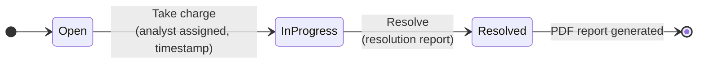
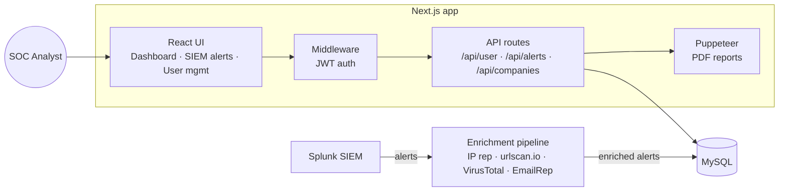

<div align="center">

# 🛡️ TIES — Threat Intelligence Enrichment System

**A SOC-oriented web platform that turns raw SIEM alerts into enriched, actionable incidents.**

IOC enrichment · Alert triage workflow · Multi-tenant access control · Automatic PDF incident reports


</div>

---

## 📌 Overview

SOC analysts spend a large share of their time manually pivoting on the **Indicators of Compromise (IOCs)** found in an alert: checking an IP's reputation, scanning a URL, looking up a domain or a file hash. **TIES** centralizes this work.

Alerts coming from the SIEM (Splunk) are stored together with their **enrichment data** (IP reputation, URL scans, domain and hash analysis, email reputation). Analysts can then view everything in a single interface, take ownership of an alert, resolve it and produce a **PDF incident report** automatically.

The platform is **multi-tenant**: each client company only sees its own alerts, and access is governed by a three-level role model.

---

## ✨ Features

### 🔎 IOC enrichment view
Each alert shows the **raw SIEM event** next to the **enriched indicators**:

| Indicator | Enrichment shown |
|---|---|
| IP address | Reputation / abuse confidence score |
| URL | [urlscan.io](https://urlscan.io) scan result |
| Domain | VirusTotal analysis stats (malicious / suspicious / harmless) |
| File hash | VirusTotal lookup |
| Email | Email reputation |
| User, hostname, user agent, process | Contextual data extracted from the event |

The raw-event panel highlights the key fields (IP, domain, email, ports) and turns them into **one-click pivot links** to external tools (IP score, domain score, port lookup).

### 🚨 Alert triage workflow

- **Take charge**: an analyst claims an open alert, which is locked to them.
- **Resolve**: only the assigned analyst can close it, writing a resolution report.
- **PDF report**: generated server-side with Puppeteer. It includes general details, the resolution report, raw data and enrichment.
- Filters by **date range**, **category** and **status**.

### 🏢 Multi-tenant user management
| Role | Can do |
|---|---|
| **Admin** | Manage client companies (incl. VIP flag) and create **editor** accounts for each company |
| **Editor** (SOC analyst) | Create **users** for their own company, take charge of and resolve alerts |
| **User** | Consult the dashboard and the company's alerts |

### 🔐 Security
- Passwords hashed with **bcrypt**
- Stateless sessions with **JWT** in an `httpOnly`, `sameSite=strict` cookie (1h expiry)
- **Next.js middleware** protecting every non-public route
- Server-side authorization checks on every API route (role, company ownership, alert assignment)
- Parameterized SQL queries (protection against SQL injection)

---

## 🏗️ Architecture



### Data model (main tables)
| Table | Purpose |
|---|---|
| `company` | Client companies (`name`, `p_iva`, `vip`) |
| `users` | Accounts with `role` (`admin` / `editor` / `user`) and `company` |
| `alerts` | SIEM alerts: `rule`, `category`, `severity`, `raw_data`, `enrichment` |
| `work` | Triage state per alert: `status`, `soc_id`, `taken_ts`, `resolved_ts`, `report`, `company` |

---

## 📁 Project structure

```
threat-intelligence-enrichment-system/
├── docs/
│   └── TIES-UseCase_v0.1.drawio      # UML use-case diagram
├── poc_programs/                     # Python proof-of-concept programs for the core features
└── fullstack/ties/                   # Next.js application
    ├── app/
    │   ├── api/
    │   │   ├── alerts/               # getAllAlerts, takeCharge, markResolved, saveResolvedReport
    │   │   ├── companies/            # company CRUD (admin)
    │   │   └── user/                 # login, logout, info, create, management, register
    │   ├── login/                    # login page
    │   ├── siem-alerts/              # alerts page
    │   └── user-managment/           # user management page
    ├── components/                   # dashboard, navbar, siem (list / view / raw), userManagement
    ├── config/db.js                  # MySQL connection pool
    ├── types/                        # AlertData, User, Company types
    └── middleware.ts                 # route protection
```

---

## 🚀 Getting started

### Prerequisites
- Node.js 18+
- A MySQL instance with the tables described above

### Installation
```bash
git clone https://github.com/AlessioMalafronte/threat-intelligence-enrichment-system.git
cd threat-intelligence-enrichment-system/fullstack/ties
npm install
```

### Environment variables
Create `fullstack/ties/.env.local`:
```env
DB_HOST=localhost
DB_USER=ties
DB_PASSWORD=your_password
DB_NAME=ties
JWT_SECRET=a_long_random_secret
NEXT_PUBLIC_GOOGLE_CLIENT_ID=your_google_oauth_client_id   # optional
```

### Run
```bash
npm run dev          # development, http://localhost:3000
npm run build && npm start   # production
```

To create the first admin account, generate a bcrypt hash with `node components/tools/hash_gen.js <password>` and insert the user directly into the `users` table.

---

## 🧭 Use cases

The UML use-case diagram is in [`docs/TIES-UseCase_v0.1.drawio`](docs/TIES-UseCase_v0.1.drawio) (open it with [draw.io](https://app.diagrams.net)). Main use cases for the **SOC Analyst** actor:

- Login · View SIEM logs (Splunk) · View threat actors
- Check IP · Check domain · Check credentials (Enzoic API)
- Check user info · Block users · Modify threat patterns
- Start a video call with the client (Webex API)

---

## 🗺️ Roadmap

- [ ] Google OAuth login (UI ready, backend route to implement)
- [ ] Live dashboard counters (alerts, threat actors)
- [ ] Threat actors view and threat-pattern management
- [ ] Credential leak checks (Enzoic) and Webex integration
- [ ] Docker Compose setup (app + MySQL) and SQL schema/seed script

---

## 🔗 Original repository

[D1D02/threat-intelligence-enrichment-system](https://github.com/D1D02/threat-intelligence-enrichment-system)
